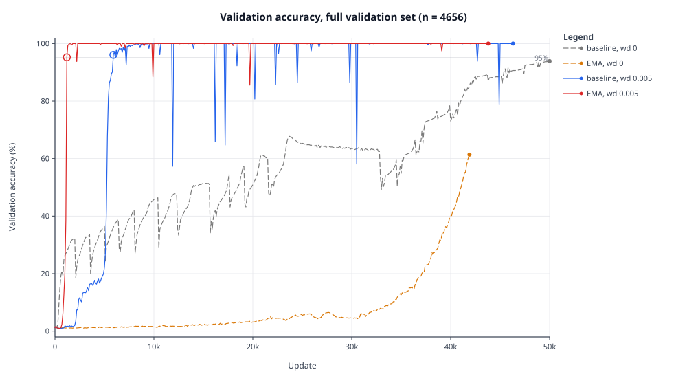
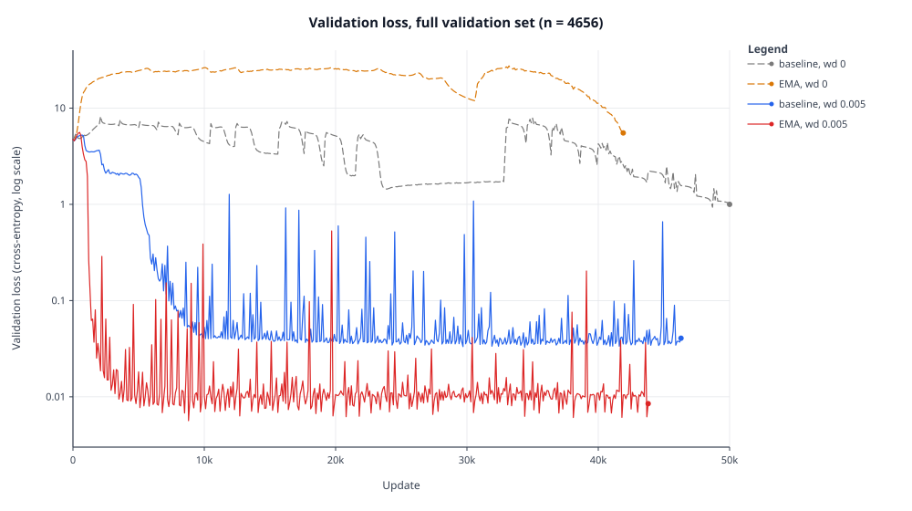

# Grokfast-EMA comparison study

Small, self-contained CPU runner for the Grokfast modular-multiplication
grokking setup, with a resource pilot and a capped four-arm comparison study.
How this study compares with the Grokfast paper: [paper_vs_study.md](paper_vs_study.md).

## Study outputs

The authoritative study results are in `study_outputs/approved_comparison/`:
- **`study_report_corrected.md`** and **`study_summary_corrected.json`** are the
  corrected, authoritative derived documents.
- `study_report.md` and `study_summary.json` are the original derived documents,
  kept unmodified for provenance (they contain an invalid timing ratio and other
  issues documented in the corrected files).
- `arm_*.json` are the raw per-arm metric records.
- `what_this_taught_me.md` (repo root) is the author's reflection on the study.

## Figures



Validation accuracy on the full validation set (n = 4656), four arms, logged
every 100 updates. Y axis is validation accuracy (%); X axis is update.
Arms end at different update counts (about 50,000, 41,900, 46,300, 43,800).
With weight decay 0.005, EMA first reached 95% validation accuracy at update
1,200 and the baseline at update 5,900 (first observed on the 100-update
grid); neither weight-decay-0 arm reached 95% before it stopped; accuracy dips
below 95% appear after first crossing in both weight-decay-0.005 arms.



Validation loss (cross-entropy, log scale) on the full validation set
(n = 4656), four arms, logged every 100 updates. X axis is update. Arms end
at different update counts (about 50,000, 41,900, 46,300, 43,800).

These figures plot recorded study data only, from
`study_outputs/approved_comparison/arm_*.json`, one paired seed. The one partial
final validation of the baseline at wd 0.005 (update 46,400, 1,536 of 4,656
examples) is excluded. Numbers and caveats are in
`study_outputs/approved_comparison/study_report_corrected.md`. The script
`scripts/plot_figures.py` regenerates the figures from the saved records.

## Multi-seed extension (five paired seeds)

The single-seed study above is unchanged. A five-seed extension runs the same four-arm design (Grokfast-EMA vs no filter, at weight decay 0 and 0.005) on five paired seeds, every arm to 50,000 updates, under a prospective analysis specification committed before this comparison's scoring (docs/analysis_spec.md). Run records live in study_outputs/multiseed_*/; the analysis (script, regression tests, outputs) lives in analysis/. An earlier version of the analysis mis-computed two marginal medians by dropping censored seeds; the correction is documented in docs/analysis_corrections.md.

Crossing rule: the first evaluation at or above 99% validation accuracy that is never followed by a drop below that threshold. An arm that has not crossed by the final evaluation is right-censored at the cap - never counted as crossing at 50,000, never dropped.

Results, from the committed analysis outputs only:

- Weight decay 0: baseline crossed in 0 of 5 seeds (marginal median not estimable within the horizon); EMA crossed in 4 of 5 (marginal median 49,700 updates; crossings 46,800-49,900). Final validation accuracy at 50,000 updates: median paired difference +12.69 percentage points for EMA (range -12.18 to +30.30), higher for EMA in 4 of 5 seeds.
- Weight decay 0.005: EMA crossed in 5 of 5 seeds (marginal median 44,700 updates); baseline in 4 of 5 (marginal median 46,900). In the 4 pairs where both arms crossed, the median paired crossing difference was -700 updates (EMA minus baseline; range -29,300 to +23,700, including one seed where baseline crossed much earlier); in the fifth pair EMA crossed while baseline was censored. All both-crossed pairs ended at 100% validation accuracy.
- Scope: five descriptive seeds. These numbers characterize this sample under this protocol; they are not a general or causal claim.

Seeds 1 and 4 ran under an amended wall-clock budget (2,100 s/arm instead of 1,500 s) to reach the same 50,000-update cap; for the two arm-pairs checked, the recorded validation curves match the superseded partial runs exactly over the shared prefix (a recorded-curve comparison only - it cannot prove determinism); the other rerun arms were not part of that check, so their comparability rests on same-code, same-seed, same-cap reasoning and remains an assumption. This is disclosed in the analysis records.

## Sources

Model/data/filter logic reused with attribution from `ironjr/grokfast`
(commit `93b2248e351d4bb9e4dda8ac32a6999b8970404b`):

- `main.py`, `grokfast.py`, `README.md` (see `config.json` in pilot output).

Upstream notices remain with the upstream project (MIT). Local adaptations are
documented in `grokfast.py`.

## Task

- Multiplication mod 97: `x * y % 97`, `x in 0..96`, `y in 1..96`
  (9312 examples, 50/50 train/valid split).
- Five tokens per example `[x, op, y, eq, result]`, loss only on result.
- Vocab size 99 (results 0..96 plus op/eq tokens).
- Model: 2 layers, width 128, 4 heads, causal mask, pre-norm residuals.
- Optimizer: Adam (not AdamW), lr 1e-3, betas (0.9, 0.98), batch 512.
- Scheduler: `LambdaLR(lambda update: 1 if update > 10 else update/10)` (10 updates).
- Weight decay is coupled (Adam `weight_decay`), set per arm.

## Arms (sequential, identical init/split/order)

1. `none_wd0` — no filter, weight_decay 0
2. `ema_wd0` — EMA filter, weight_decay 0
3. `none_wd0.005` — no filter, weight_decay 0.005
4. `ema_wd0.005` — EMA filter, weight_decay 0.005

EMA: alpha 0.98, lambda 2.0, applied after backward and before `optimizer.step()`.
State initialized from the first raw gradient (first modified grad = 3x raw).

## RNG / seeding

- Model init: `torch.manual_seed(0)` immediately before construction.
- Split: separate `torch.Generator().manual_seed(0)`.
- Batch order: separate `torch.Generator().manual_seed(0)`.
- These independent streams differ from upstream's single global stream, so exact
  upstream trajectories are not reproduced, but all arms share identical
  init/split/order.

Train metrics are recorded online per update (no repeated full-train passes).
Validation runs at steps 0 and 100 (if reached) on the full validation set.

## Running tests

```
PYTHONPATH=. /path/to/python -m unittest discover -s tests
```

## Running the pilot

```
python runner.py --pilot
```

Inspects existing records first; refuses to rerun if `pilot_outputs/` is non-empty.

## Pilot result

All four arms completed 100 updates. Recorded total elapsed 8.356290792 s
(limit 600 s). Peak RSS 322748416 bytes (~307.8 MiB, process peak, CPU).

Most updates use 512 examples and take ~0.019-0.020 s; every tenth update uses
the 48-example final partial batch and takes ~0.005-0.006 s. The latter is NOT
steady-state speed.

Per-arm 100-update means (from recorded update times):
- none/0: 0.0181545 s
- EMA/0: 0.0186113 s
- none/0.005: 0.0181268 s
- EMA/0.005: 0.0177931 s

All 400 updates sum 7.268574705 s. Recorded pilot total 8.356290792 s; the
residual 1.087716087 s combines setup, eight validation passes, checkpoint/I/O
and other overhead, NOT separately measured validation time. Final report writes
were outside that recorded total.

| Arm | Status | Updates | Val@0 acc | Val@100 acc |
|---|---|---|---|---|
| none_wd0 | completed_100_updates | 100 | 0.0120 | 0.0114 |
| ema_wd0 | completed_100_updates | 100 | 0.0120 | 0.0157 |
| none_wd0.005 | completed_100_updates | 100 | 0.0120 | 0.0146 |
| ema_wd0.005 | completed_100_updates | 100 | 0.0120 | 0.0178 |

This pilot establishes resources only, not grokking speedup.

## Future budget (no approved run)

The recorded means above are the only supported timing evidence. A 50k-update
per-arm extrapolation is ~61 minutes training alone across four arms, with no
measured long-run completion guarantee. No validation-pass duration was measured
separately. No run budget is approved here.
